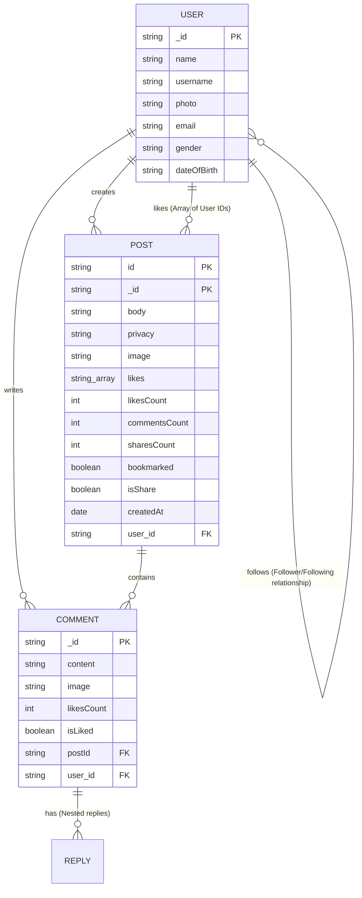
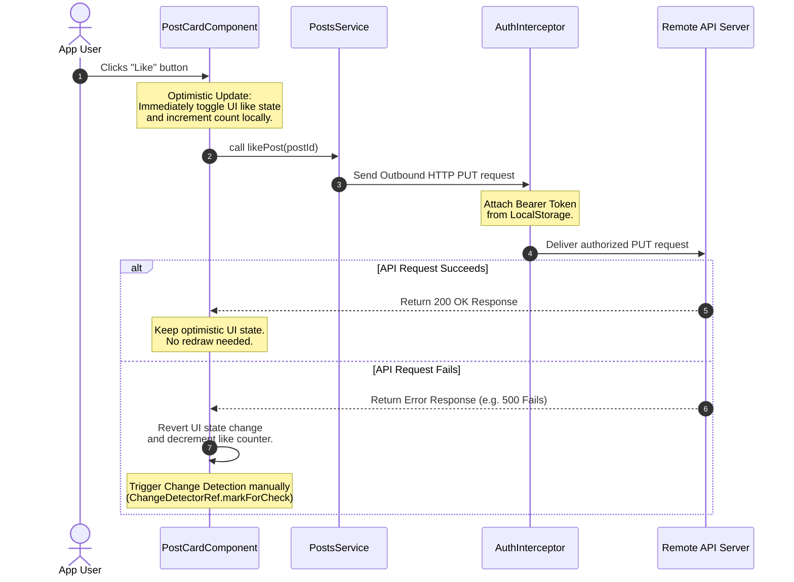

# Social Media Web Application

A premium, high-performance, and feature-rich social media frontend client built using modern **Angular 21**, **Tailwind CSS v4**, **Flowbite**, and **RxJS**. This application utilizes the latest front-end paradigms, including **Zoneless Change Detection**, **CSS View Transitions**, and **Optimistic UI Rendering** to deliver a responsive, state-of-the-art user experience. It integrates with a secure RESTful backend API to support authentication, social feeds, user profiles, image uploads, bookmarks, and real-time polling notifications.

---

## Project Overview

### What the System Does
This system serves as a modern, interactive social media client. It connects users globally through a visual microblogging experience, enabling them to:
- Authenticate securely via token-based session management.
- Post text updates and upload images using multi-part form submissions.
- Interact with content through real-time liking, bookmarking, and post-sharing.
- Communicate on posts through multi-level comment threads and replies (with image attachments support).
- Follow or unfollow other members of the community to curate their personal feed.
- Receive reactive unread notification counters and list updates via automated backend polling.
- Personalize accounts by updating profile images and managing passwords.

### Problem It Solves
Traditional social applications suffer from high latency, heavy layout shifts during page transitions, and excessive rendering cycles due to bloated change-detection frameworks (like zone-based change detection). This client application resolves these issues by implementing:
1. **Optimistic UI Updates**: Operations such as liking or bookmarking posts update the UI immediately, rolling back changes only if the background API call fails.
2. **Zoneless Angular execution**: Disabling zones prevents unneeded change-detection cycles, lowering CPU utilization and browser memory footprint.
3. **Lazy-loaded Routing with Native transitions**: Enables fluid transitions between routes while loading modules dynamically to minimize the initial bundle size.

### Business Value
For businesses or developers showcasing state-of-the-art frontend engineering, this project represents:
- **Scalability**: A clean feature-based modular folder structure (Screaming Architecture) that isolates domains (Auth, Feed, Notifications, Profile) and allows developers to scale features independently.
- **Flawless User Experience**: By optimizing rendering cycles, implementing skeleton loaders, and utilizing CSS view transitions, it keeps bounce rates low and keeps users engaged.
- **Maintainability**: Clear separation of concern rules where components consume services that handle external integration layers, keeping views decoupled from networking protocols.

### Target Users
- **Active Community Members**: Individuals seeking a rapid, streamlined platform to share updates, bookmark reference articles, and follow relevant peers.
- **Content Creators**: Users publishing multimedia posts and replying to feedback threads.

---

## Key Features

1. **Secure Session Authentication**: Reactive Login and Register forms with comprehensive client-side regex validations, session token storage, and Route Guards.
2. **Interactive Global & Community Feeds**: Dynamic tab switching between a Global Feed (all posts) and a personalized Community Feed (posts from followed accounts) with progressive pagination loaders.
3. **Multimedia Publishing**: Support for creating, editing, and deleting posts containing both text bodies and image files using `FormData` uploads.
4. **Optimistic Interactions**: Instantly like, bookmark, or share posts. The UI reflects incremented/decremented counters immediately, with automatic server-reversal logic on API failure.
5. **Dynamic Notification Center**: Displays structured notifications (likes, comments, follows, shares, and replies) with type-specific color palettes and icons. Uses background interval polling to update unread counts globally in the navigation bar.
6. **Threaded Comment Engine**: Real-time comment publishing with image uploads and nested reply support for individual comment nodes.
7. **Comprehensive User Profiles**: Dedicated profile routing for the authenticated session and other members. Features modal password management and live profile photo replacement.

---

## System Architecture

The application is structured around a **Feature-Based Modular Architecture** (similar to Screaming Architecture), segregating core app infrastructure, reusable presentation elements, and domain-specific features.

```mermaid
graph TD
    subgraph Core Layer
        A[App Config & Zoneless Provider] --> B[Auth Guard]
        A --> C[Auth Interceptor]
        A --> D[Layouts: Main / Auth]
    end

    subgraph Application Layer [Feature Modules]
        E[Auth Feature]
        F[Feed Feature]
        G[Notifications Feature]
        H[Profile Feature]
    end

    subgraph Shared Layer
        I[Post Card Component]
        J[Comments System]
        K[TimeAgo Pipe]
        L[Confirm Dialog Component]
    end

    subgraph Infrastructure [External Services]
        M[Remote REST API]
        N[LocalStorage Security]
    end

    %% Dependency flow
    B -->|Protects Route| D
    C -->|Attaches Auth Headers| M
    E -->|Uses| AuthService
    F -->|Uses| FeedService & CommentsService
    G -->|Uses| NotificationsService
    H -->|Uses| UsersService
    
    Shared Layer -->|Injected Services| PostsService & UsersService
    PostsService -->|HTTP Calls| M
    UsersService -->|HTTP Calls| M
    AuthService -->|HTTP Calls| M
    NotificationsService -->|HTTP Calls| M
    
    D -->|Renders Layout Outlets| Application Layer
    Application Layer -->|Embeds| Shared Layer
```

### Layer Responsibilities

1. **Core Layer**: Manages the application bootstrap configuration. Houses global routing guards (`authGuard`), global HTTP request middleware (`authInterceptor`), and structural base layouts (`AuthLayoutComponent`, `MainLayoutComponent`).
2. **Feature Modules (Application Layer)**: Contains isolated functional packages (Auth, Feed, Notifications, Profile). Each feature owns its routing configurations, unique page components, and feature-scoped services.
3. **Shared Layer**: Houses cross-cutting UI elements (e.g., `PostCardComponent`, `ConfirmDialogComponent`, skeleton loaders) and utilities (`TimeAgoPipe`) shared by multiple features.
4. **Infrastructure Layer**: Encompasses environmental config endpoints (`environment.ts`), remote REST API communication endpoints (`App_Apis`), and browser storage management (`localStorage`).

---


## Tech Stack

| Technology | Purpose | Exact Version |
|:---|:---|:---|
| **Angular** | Core SPA Framework (Platform Browser, Router, Forms, Compiler) | `^21.1.0` |
| **Tailwind CSS** | Sleek CSS Utility-first Grid & Styling Framework | `^4.2.2` |
| **Flowbite** | Pre-packaged Tailwind UI widgets and dynamic components | `^4.0.1` |
| **RxJS** | Reactive Extensions (Observable streams, BehaviorSubjects, Polling) | `~7.8.0` |
| **FontAwesome** | Global Visual Icon System | `^7.2.0` |
| **ngx-infinite-scroll** | Declarative container scroll listeners | `^21.0.0` |
| **TypeScript** | Strongly-typed static compilation language | `~5.9.2` |
| **Vitest** | Fast next-generation unit test runner | `^4.0.8` |
| **jsdom** | Test environment mimicking full browser DOM | `^27.1.0` |
| **Angular CLI** | Command line interface tools for builds and compilation | `^21.1.2` |

---

## Database Design

Since this is a client application, database persistence is managed on the backend database. However, the client models represent this structured schema:



### Main Client Data Models

1. **User Entity**:
   - Represents profile data. Uniquely identified by `_id`. Holds identity credentials (`name`, `username`, `email`), user avatar links (`photo`), and metadata details (`gender`, `dateOfBirth`).
2. **Post Entity**:
   - Holds core social messages. Tracks counters (`likesCount`, `commentsCount`, `sharesCount`), engagement lists (an array of User IDs under `likes`), layout variables (`bookmarked`, `isShare`), and file uploads (`image`). Uniquely tied to an author (`User`).
3. **Comment Entity**:
   - Linked to a `Post` through parent identifiers. Holds comments body text (`content`), potential screenshot attachments (`image`), and ownership details (`commentCreator`/`user`).

---

## Authentication & Authorization

Secured session tracking is implemented using JWT tokens and client-side guards:

```
                  +-----------------------------------+
                  |        Main Application Route      |
                  +-----------------+-----------------+
                                    |
                                    v (Protected by authGuard)
                     LocalStorage has Token?
                     /                     \
                    YES                    NO
                   /                         \
                  v                           v
     +------------+-------------+    +--------+--------+
     |   Allow main-layout      |    | Redirect to     |
     |   routes (Feed, Profile) |    | /auth/login     |
     +------------+-------------+    +-----------------+
                  |
                  v
     +------------+-------------+
     |     authInterceptor      |
     |   Clones Request & Adds  |
     |   "Authorization" Header |
     +------------+-------------+
                  |
                  v
     +------------+-------------+
     |   Outbound API Server    |
     +--------------------------+
```

1. **JWT Verification**: Upon successful request calls to `/users/signin` or `/users/signup`, the application extracts `res.data.token` and stores it securely inside the browser `localStorage` under `authToken`.
2. **Route Authorization (`authGuard`)**:
   - Applied to the root path `''` inside the route definitions.
   - Restricts layout activations if the token is missing from storage, redirecting unauthorized workflows back to `/auth/login`.
3. **Outgoing Requests Interceptor (`authInterceptor`)**:
   - Injected globally inside [app.config.ts]
   - Dynamically appends `Authorization: Bearer <token>` headers to outgoing REST API calls, ensuring authentication verification for backend services.
4. **Session Profiles caching**:
   - User profile details are stored locally inside `userData`. This cached object provides instant access for components to evaluate profile layouts and compare author IDs dynamically (e.g. `this.currentUserId === this.post?.user?._id`).

---

## Design Patterns Used

- **Service/Repository Pattern**: Encapsulates external resource routing in injectable data classes (`AuthService`, `FeedService`, `CommentsService`, `PostsService`, `UsersService`). This decouples UI elements from structural URL configurations and networking protocols.
- **Zoneless Observer Pattern**: Employs RxJS `Subject` and `BehaviorSubject` handlers to facilitate decoupled communication between components.
  - *Example*: Creating a post in `AddPostsComponent` triggers `this.postsService.postAdded$.next(newPost)`. The active subscriber (`FeedPageComponent`) captures the change and inserts it to `allPosts`, dynamically updating the feed.
  - *Change Detection*: Leverages `ChangeDetectorRef.markForCheck()` manually to trigger UI updates without Zone.js.
- **Optimistic UI Updates Pattern**: Enhances responsiveness by immediately reflecting status changes in the UI before obtaining server validation.
  - *Example*: Liking or bookmarking a post toggles active states and updates counts in the UI. If the server request fails, the operation is rolled back in the error callback.
- **Lazy-Loaded Layout Architecture**: Implements structural layout routing. Segregates credential forms (`AuthLayoutComponent`) from core workspaces (`MainLayoutComponent`) and lazy-loads route destinations (`loadComponent`, `loadChildren`) to optimize build compilation bundles.
- **Dependency Injection**: Resolves dependencies using Angular's modern `inject()` API, enabling clean test mocks and removing boilerplate constructor requirements.

---

## API Documentation

The client communicates with the following REST endpoints mapping to the [App_Apis] configuration:

### Authentication & Profiles
| Method | Route | Description | Auth Required |
|:---|:---|:---|:---|
| **POST** | `/users/signup` | Register a new user account | No |
| **POST** | `/users/signin` | Login and acquire JWT access token | No |
| **PATCH**| `/users/change-password` | Update current user password | Yes |
| **PUT**  | `/users/upload-photo` | Upload profile image via `FormData` | Yes |
| **GET**  | `/users/profile-data` | Retrieve authenticated user profile | Yes |
| **GET**  | `/users/suggestions` | Fetch recommended user accounts | Yes |
| **GET**  | `/users/bookmarks` | Fetch user bookmarked posts list | Yes |
| **PUT**  | `/users/:userId/follow` | Follow or unfollow a user account | Yes |
| **GET**  | `/users/:userId/profile` | Retrieve profile card details for a specific user | Yes |
| **GET**  | `/users/:userId/posts` | Fetch posts written by a specific user | Yes |

### Posts Management
| Method | Route | Description | Auth Required |
|:---|:---|:---|:---|
| **GET**  | `/posts?limit=10&page=1` | Get global feed posts | Yes |
| **GET**  | `/posts/feed?limit=10&page=1` | Get personalized feed posts (community) | Yes |
| **POST** | `/posts` | Create new text/image post via `FormData` | Yes |
| **GET**  | `/posts/:postId` | Retrieve detail metrics of a single post | Yes |
| **PUT**  | `/posts/:postId` | Update post content via `FormData` | Yes |
| **DELETE**| `/posts/:postId` | Remove a post from the platform | Yes |
| **PUT**  | `/posts/:postId/like` | Like or unlike a post | Yes |
| **GET**  | `/posts/:postId/likes` | List users who liked a specific post | Yes |
| **PUT**  | `/posts/:postId/bookmark` | Add or remove a post from bookmarks | Yes |
| **POST** | `/posts/:postId/share` | Share a post to user feed | Yes |

### Comments & Replies
| Method | Route | Description | Auth Required |
|:---|:---|:---|:---|
| **GET**  | `/posts/:postId/comments?page=1&limit=10` | Fetch comment list for a post | Yes |
| **POST** | `/posts/:postId/comments` | Add new text/image comment | Yes |
| **PUT**  | `/posts/:postId/comments/:commentId` | Update an existing comment | Yes |
| **DELETE**| `/posts/:postId/comments/:commentId` | Delete a comment | Yes |
| **PUT**  | `/posts/:postId/comments/:commentId/like` | Like/unlike a comment | Yes |
| **GET**  | `/posts/:postId/comments/:commentId/replies` | Get replies to a comment | Yes |
| **POST** | `/posts/:postId/comments/:commentId/replies` | Reply to a comment | Yes |

### Notifications System
| Method | Route | Description | Auth Required |
|:---|:---|:---|:---|
| **GET**  | `/notifications?page=1&limit=20` | Get recent notification log | Yes |
| **GET**  | `/notifications/unread-count` | Get total count of unread items | Yes |
| **PATCH**| `/notifications/:notifId/read` | Mark a notification as read | Yes |
| **PATCH**| `/notifications/read-all` | Mark all notifications as read | Yes |

---

## Folder Structure

```
social-media-app/
├── public/                     # Static assets (images, favicon, etc.)
├── src/
│   ├── app/
│   │   ├── core/               # Shared global infrastructure components
│   │   │   ├── components/
│   │   │   │   └── navbar/     # Navigation bar with polling notifications
│   │   │   ├── constants/
│   │   │   │   ├── app-apis.ts    # Endpoints map
│   │   │   │   └── stored-keys.ts # LocalStorage variables
│   │   │   ├── guards/
│   │   │   │   └── auth.guard.ts  # Route authorization guard
│   │   │   ├── interceptors/
│   │   │   │   └── auth.interceptor.ts # Authorization token injector
│   │   │   ├── layouts/
│   │   │   │   ├── auth-layout/   # Outermost auth container view
│   │   │   │   └── main-layout/   # Main application shell with navbar
│   │   │   └── services/
│   │   │       ├── posts/      # Global posts data service
│   │   │       └── users/      # Profile operations and follow services
│   │   │
│   │   ├── features/           # Domain modules containing pages, routes, components
│   │   │   ├── auth/           # Login, Register pages & reactive forms
│   │   │   ├── feed/           # Core Feed Page, suggested friends logic
│   │   │   ├── notifications/  # Notifications lists & read status APIs
│   │   │   ├── profile/        # User accounts, avatar uploads, password change dialogs
│   │   │   └── static-pages/   # NotFound (404) error templates
│   │   │
│   │   ├── shared/             # Globally accessible elements
│   │   │   ├── components/
│   │   │   │   ├── add-posts/  # Post composition drawer with image preview
│   │   │   │   ├── all-posts/  # Post listings renderer
│   │   │   │   ├── comments/   # Comments list & reply composition components
│   │   │   │   ├── confirm-dialog/ # Modal component with inline CSS styles
│   │   │   │   ├── loading-skeleton/ # Dynamic visual skeletons
│   │   │   │   ├── post-card/  # Post render template with optimistic updates
│   │   │   │   └── sidebar/    # Primary navigation panel
│   │   │   └── pipes/
│   │   │       └── time-ago.pipe.ts # Custom date parser
│   │   │
│   │   ├── app.component.ts    # Root template bootstrapping
│   │   ├── app.config.ts       # Global providers configuration
│   │   └── app.routes.ts       # Lazy-loaded route map
│   │
│   ├── environments/           # Environment variables for dev/prod builds
│   ├── index.html              # Main HTML Entry point
│   ├── main.ts                 # App Bootstrapper
│   └── styles.css              # Global styles, Tailwind imports, Flowbite integration
├── angular.json                # Angular project workspace configuration
├── package.json                # Project dependencies list
└── tsconfig.json               # TypeScript compiler config
```

---

## Data Flow

This diagram illustrates the reactive data flow during a post-like operation, showcasing how components use optimistic updates and rollback mechanisms.



---

## Configuration

### Environment Files
Backend routing configurations are defined in the `src/environments` directory.

- **Development Config** ([environment.development.ts]):
  ```typescript
  export const environment = {
      production: false,
      apiUrl: 'https://route.dev.com',
      baseUrl: 'https://route-posts.routemisr.com'
  };
  ```
- **Production Config** ([environment.ts]):
  ```typescript
  export const environment = {
      production: true,
      apiUrl: 'https://route.com',
      baseUrl: 'https://route-posts.routemisr.com'
  };
  ```

### Browser Storage Schema
Session persistence uses standard `localStorage` wrapper values:
- `authToken`: Holds the raw JWT session token string.
- `userData`: Stores JSON stringified properties of the authenticated user (such as `_id`, `name`, `username`, and `photo` avatar link).

---

## Installation Guide

### Prerequisites
Ensure you have the following installed on your machine:
- **Node.js** (v18.0.0 or higher recommended)
- **npm** (v9.0.0 or higher recommended)
- **Angular CLI** (v21.1.2) - (Can be run locally via `npx ng`)

### Setup and Running Instructions

1. **Clone the repository**:
   ```bash
   git clone <repository-url>
   cd Social-Media/social-media-app
   ```

2. **Install project dependencies**:
   ```bash
   npm install
   ```

3. **Start the local development server**:
   ```bash
   npm start
   # or
   npx ng serve
   ```
   Once compiled, navigate to `http://localhost:4200/` inside your browser. The application will hot-reload automatically as source code changes are saved.

4. **Execute unit tests using Vitest**:
   ```bash
   npm test
   # or
   npx vitest
   ```

5. **Generate a production build bundle**:
   ```bash
   npm run build
   ```
   Compiled build assets will be written to the `dist/` output directory, ready for deployment.

---

## Security Features

1. **JWT Authentication Propagation**: Automates API request credentials validation using the `authInterceptor` middleware, preventing insecure route credentials transmission.
2. **Client-Side Route Guardians**: Router verification guards restrict direct URL access to protected pages (such as `/feed`, `/profile`, or `/notifications`) for non-authenticated sessions.
3. **Cross-Site Scripting (XSS) Mitigation**: The application relies on Angular's context-aware element compiler, which automatically sanitizes variables rendered in HTML templates.
4. **Regex Validation Rules**: Integrates regex patterns (`/^(?=.*?[A-Z])(?=.*?[a-z])(?=.*?[0-9])(?=.*?[#?!@$%^&*-]).{8,}$/`) on passwords inside Reactive Forms during registration, validating requirements locally before hitting the database.

---

## Performance Optimizations

1. **Zoneless Change Detection**: By bootstrapping the app with `provideZonelessChangeDetection()` in [app.config.ts], the application runs without Zone.js. This removes global change-detection sweeps, improving rendering speeds.
2. **On-Demand Route Loading**: Implements route-level lazy loading (`loadComponent` and `loadChildren`) in routing rules, reducing the initial client load size.
3. **Optimistic Updates**: Eliminates perceived network latency during likes, shares, or bookmarks by updating component layouts before backend APIs confirm requests.
4. **CSS View Transitions**: Integrated `withViewTransitions()` in the router config provider to enable smooth browser transitions between layouts and minimize user-perceived load times.
5. **Paginated Data Streams**: Fetches feed items and comments in chunks of 10, preventing heavy DOM layouts and rendering slowdowns.

---

## Error Handling

- **Global Error Listeners**: Configured with `provideBrowserGlobalErrorListeners()` in the app config to capture unhandled browser exceptions.
- **Graceful API Failures**: RxJS `catchError` and fallback defaults in data services prevent application crashes. For example:
  - Cache fallbacks load credentials locally from `localStorage` if profile requests fail.
  - Reset operators clear badge counters locally even if the unread notification endpoint fails.
- **Reactive UI Banners**: Error indicators with "Try Again" triggers let users recover gracefully when connection issues occur.

---

## Future Enhancements

- **Offline DB Syncing**: Implement Service Workers with IndexedDB to support reading and drafting offline posts that auto-sync once connectivity is restored.
- **Real-Time WebSockets**: Integrate WebSockets or SignalR protocols to replace polling loops, updating user feeds and notifications instantly.
- **Signals State Management**: Refactor RxJS Subject flows to Angular Signals (e.g. `@ngrx/signals`) for streamlined state updates in components.
- **Forgotten Passwords Flow**: Build out functional backend handlers for password recovery routes (`/auth/forget-password`).
- **Nginx & Docker Containerization**: Create production Docker configurations utilizing multi-stage Nginx builds for cloud container platforms.

---

## Project Highlights

- **Angular 21 Standard**: Embraces modern Angular features, including standalone components, zoneless execution, component-bound style encapsulation, and modern providers.
- **Premium Design System**: Styled using Tailwind CSS v4 and Flowbite, providing smooth CSS transitions, modern typography, a dark-accented navy color palette, and unified interactive components.
- **Clean Architecture Principles**: Adheres to modular folder separation, keeping business domains, presentation elements, and global layouts separate.
- **High-Performance Architecture**: Uses optimistic rendering, view transitions, lazy loading, and paginated requests to deliver a fast, responsive user experience.
